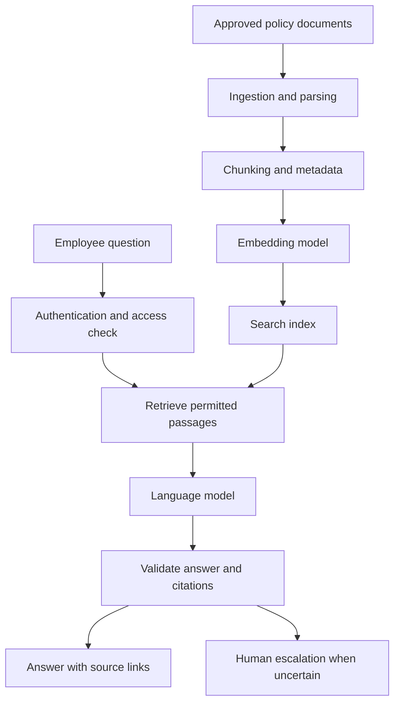

# AI Applications in the Real World

## Learning objectives

- Recognize common AI use cases across industries.
- Connect business problems to possible technical approaches.
- Identify risks and failure modes.
- Practice framing an AI project as an engineering problem.

## 1. Start with the problem, not the model

A common mistake is to begin with "we should use an LLM" before understanding the task.

A better process is:

1. Identify the user and the problem.
2. Define the desired outcome.
3. Understand the data and permissions.
4. Establish acceptable error rates and failure behavior.
5. Compare rules, search, ML, generative AI and hybrid approaches.
6. Build a baseline.
7. Evaluate against realistic cases.
8. Deploy with monitoring and a fallback path.

Sometimes the best solution is ordinary software rather than AI.

## 2. Industry examples

| Domain | Example use case | Possible approach | Important consideration |
|---|---|---|---|
| Healthcare | Assist with medical-image triage | Computer vision | Clinical validation and human oversight |
| Banking | Detect unusual transactions | Anomaly detection / supervised ML | False positives and fairness |
| Education | Generate practice questions | LLM | Accuracy and age-appropriate content |
| Retail | Recommend products | Ranking and recommendation models | Privacy and feedback loops |
| Manufacturing | Detect product defects | Computer vision | Sensor and camera variation |
| Transport | Estimate arrival times | Predictive models | Changing traffic conditions |
| Cybersecurity | Prioritize suspicious events | ML plus rules | Adversarial behavior |
| Agriculture | Identify crop stress | Computer vision and sensor models | Local conditions and data quality |
| Customer support | Retrieve policy answers | Search and RAG | Correct source retrieval |
| Software engineering | Assist with code explanation | LLM plus tools | Secure code execution and review |

These are illustrative patterns. A real deployment needs domain-specific evidence and validation.

## 3. Example: Customer support knowledge assistant

Suppose a company wants employees to ask questions about internal policies.

A possible architecture:

Important design decisions:

- Employees should only retrieve documents they are authorized to see.
- Answers should cite the source passages used.
- The system should say when it cannot find sufficient evidence.
- Policy changes need an ingestion and re-indexing process.
- Logs must be designed with privacy and retention requirements in mind.
- Quality should be tested against a representative set of real questions.

## 4. Evaluating an AI use case

Before deployment, define measurable criteria.

For a document assistant, possible measures include:

- Retrieval recall: does search find the relevant source?
- Answer correctness: is the response supported by the source?
- Citation correctness: do citations point to the right passages?
- Abstention quality: does the system avoid guessing when evidence is missing?
- Latency: how long does a response take?
- Cost: what is the cost per successful task?
- Security: can a user access another user's restricted data?

No single metric is sufficient.

## 5. When not to use AI

Prefer conventional software when:

- The rules are stable, explicit and easy to maintain.
- Exact arithmetic or deterministic validation is required.
- The task has no meaningful uncertainty or learning requirement.
- A model would add cost, latency or risk without user value.

A hybrid approach is often appropriate: use a model for ambiguous language, but enforce permissions, financial calculations and critical business constraints in deterministic code.

## 6. Practical exercise

Choose one problem from your workplace or a product you use.

Write a one-page proposal containing:

1. User and problem.
2. Current process.
3. Desired outcome.
4. Candidate approaches.
5. Data required and permission to use it.
6. Success metrics.
7. Failure scenarios.
8. Human review or fallback.
9. Estimated operational cost.
10. A small proof-of-concept plan.

## 7. Summary

AI can support many industries, but successful applications begin with a clearly defined problem and measurable requirements. Select the simplest approach that meets the need, test it against realistic data and design for failures from the beginning.

## 8. Further reading

- [NIST AI Risk Management Framework](https://www.nist.gov/itl/ai-risk-management-framework)
- [NIST Generative AI Profile](https://nvlpubs.nist.gov/nistpubs/ai/NIST.AI.600-1.pdf)
- [Google People + AI Guidebook](https://pair.withgoogle.com/guidebook/)
