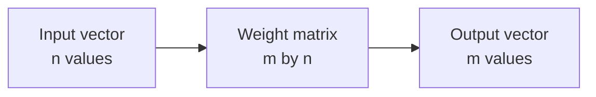

# Linear Algebra

**Difficulty:** Beginner to intermediate  
**Prerequisites:** Mathematical foundations; comfort with coordinates and equations is helpful.

## Overview

Linear algebra studies vectors, matrices, and transformations between spaces. In AI, it is a language for storing collections of numbers and describing many model computations compactly.

## Topics Covered

### Essential representations

- Scalars, vectors, matrices, and tensors; a tensor is a general name for an array with one or more dimensions.
- Shape and dimension: how many values each object contains and which operations fit.
- Vector addition, scalar multiplication, dot products, and matrix multiplication.
- Transpose, identity matrix, and matrix-vector multiplication.

### Geometry and comparison

- Norms as measures of vector size and distance.
- Linear combinations, span, basis, and linear independence at an intuitive level.
- A matrix as a transformation that rotates, scales, or combines coordinates.
- Orthogonality and projection as ways to compare or separate directions.

### Useful intermediate ideas

- Eigenvectors and eigenvalues as directions preserved by a transformation and their scale factors.
- Singular value decomposition (SVD) as a factorization that exposes important directions and scales.
- Rank as the number of independent directions represented by a matrix.

## AI Applications

Rows and columns organize examples and features. A neural-network layer multiplies an input representation by learned weights, then applies another operation. Embeddings represent items as vectors so similarity can be compared. PCA and related methods use matrix factorizations to summarize or compress data. Understanding shapes also helps catch implementation errors.

The diagram shows the shape relationship for one matrix-vector multiplication: an input with `n` values and a weight matrix with `m` rows and `n` columns produce an output with `m` values.

## Recommended References

- [MIT OpenCourseWare 18.06: Linear Algebra](https://ocw.mit.edu/courses/18-06-linear-algebra-spring-2010/) — full university course; select lectures on vectors, matrix multiplication, subspaces, eigenvalues, and SVD.
- [3Blue1Brown: Essence of Linear Algebra](https://www.3blue1brown.com/topics/linear-algebra) — visual intuition; pair it with exercises because videos are not a complete course.
- [Mathematics for Machine Learning](https://mml-book.github.io/) — free online book; useful for a more mathematical bridge to ML.

---

[← Previous: Mathematical Foundations](01-mathematical-foundations.md) · [Next: Calculus →](03-calculus.md)
