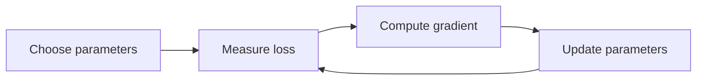

# Optimization Mathematics

**Difficulty:** Intermediate  
**Prerequisites:** Linear algebra and basic derivatives; probability is useful for stochastic methods.

## Overview

Optimization is the search for inputs or parameters that make an objective as good as possible. In machine learning, the objective is often a loss function that measures how far predictions are from desired outcomes.

## Topics Covered

### Formulate the problem

- Parameters, objective or loss function, and constraints.
- Minimization versus maximization.
- Local and global optima; a neural-network objective is generally non-convex, so a local solution need not be globally best.
- Convex sets and functions as a setting where useful global guarantees are possible.

### Gradient-based methods

- Gradient descent and learning rate.
- Mini-batch stochastic gradient descent and gradient noise.
- Momentum and adaptive methods such as Adam at a high level.
- Convergence behavior, scaling, and why an unsuitable learning rate can stall or destabilize training.

### Constraints and generalization

- Constrained optimization and regularization as related but distinct ways to express preferences about solutions.
- L1 and L2 penalties as common examples.
- The practical difference between minimizing training loss and achieving good performance on new data.

## AI Applications

Training adjusts model parameters to lower a loss. Gradient-based optimization makes this feasible for models with many parameters, while regularization can discourage overly complex solutions. Optimization ideas also appear in planning, resource allocation, and fitting probabilistic models.

This loop is a simplified view of gradient-based training. Real systems add batching, optimizer state, constraints, and stopping rules.

## Recommended References

- [Google Machine Learning Crash Course: Gradient Descent](https://developers.google.com/machine-learning/crash-course) — practical and visual introduction to loss, gradients, and optimization in ML.
- [Convex Optimization by Boyd and Vandenberghe](https://web.stanford.edu/~boyd/cvxbook/) — free online textbook; rigorous and best used selectively after the basics.
- [Stanford CS229: Convex Optimization notes](https://cs229.stanford.edu/section/cs229-cvxopt.pdf) — concise university notes; assumes mathematical maturity.

---

[← Previous: Statistics](05-statistics.md){ .md-button } [Next: Information Theory →](07-information-theory.md){ .md-button .md-button--primary }
