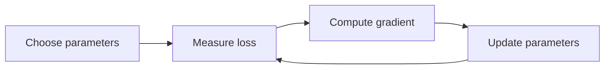

# Optimization Mathematics

## Learning objectives

By the end of this guide, you should be able to:

- Explain how a loss measures a model's error on examples.
- Describe how gradient descent uses a slope and learning rate to update parameters.
- Distinguish lower training loss from better performance on new data.

**Difficulty:** Intermediate  
**Prerequisites:** Linear algebra and basic derivatives; probability is useful for stochastic methods.

## Overview

Optimization is the search for inputs or parameters that make an objective as good as possible. In machine learning, the objective is often a loss function that measures how far predictions are from desired outcomes.

## Topics Covered

### Formulate the problem

- Parameters, objective or loss function, and constraints.
- Minimization versus maximization.
- Local and global optima; a neural-network objective is generally non-convex, so a local solution need not be globally best.
- Convex sets and functions as a setting where useful global guarantees are possible.

### Gradient-based methods

- Gradient descent and learning rate.
- Mini-batch stochastic gradient descent and gradient noise.
- Momentum and adaptive methods such as Adam at a high level.
- Convergence behavior, scaling, and why an unsuitable learning rate can stall or destabilize training.

### Constraints and generalization

- Constrained optimization and regularization as related but distinct ways to express preferences about solutions.
- L1 and L2 penalties as common examples.
- The practical difference between minimizing training loss and achieving good performance on new data.

## Learn the idea

Optimization means choosing values that make a score as small or large as possible. In model training, the score is often a loss: a number that is smaller when predictions better match the examples used for training. Parameters are the values the learning process adjusts.

Gradient descent uses the slope of the loss to choose a direction. The learning rate sets the step size. A step that is too small can take a long time; one that is too large can jump past a good value. Lower training loss alone does not prove that a model will work well on new examples, so evaluation on separate data still matters.

## Example in AI: training by lowering loss

Imagine a model parameter `w` controls how strongly a feature affects a prediction. Training tries to choose `w` so examples receive lower loss. For a simple illustration, let `L(w) = (w − 2)²`, with derivative `2(w − 2)`. Starting at `w = 0`, the slope is `−4`. With learning rate `0.25`, gradient descent updates the parameter to `0 − 0.25 × (−4) = 1`; the loss falls from 4 to 1. Optimization is useful because a model may have many parameters and needs a repeatable way to improve them. Real model losses can be much more complicated than this bowl-shaped example.

## Try it

For this same loss, what is the loss at `w = 3`?

??? success "Check your answer"
    `(3 − 2)² = 1`.

## AI Applications

Training adjusts model parameters to lower a loss. Gradient-based optimization makes this feasible for models with many parameters, while regularization can discourage overly complex solutions. Optimization ideas also appear in planning, resource allocation, and fitting probabilistic models.

This loop is a simplified view of gradient-based training. Real systems add batching, optimizer state, constraints, and stopping rules.

## Recommended References

- [Google Machine Learning Crash Course: Gradient Descent](https://developers.google.com/machine-learning/crash-course) — practical and visual introduction to loss, gradients, and optimization in ML.
- [Convex Optimization by Boyd and Vandenberghe](https://web.stanford.edu/~boyd/cvxbook/) — free online textbook; rigorous and best used selectively after the basics.
- [Stanford CS229: Convex Optimization notes](https://cs229.stanford.edu/section/cs229-cvxopt.pdf) — concise university notes; assumes mathematical maturity.

---

[← Previous: Statistics](05-statistics.md) · [Next: Information Theory →](07-information-theory.md)
