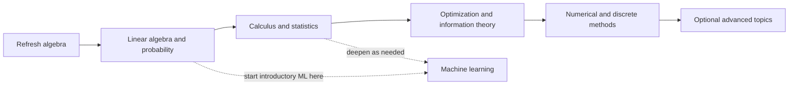

# Mathematics for AI

This section is a study guide, not a mathematics textbook. It explains which ideas are useful for AI, what to learn first, and where to go for a deeper course or explanation. The summaries and diagrams here are original; external resources are linked for further study.

## Before you begin

You do not need to master every topic before starting machine learning. Comfort with school algebra, functions, graphs, fractions, and basic exponents is enough to begin introductory ML. Learn the core ideas as they become useful, then return to the relevant sections for more depth.

## Recommended learning path

| Stage | Study | Why it helps |
| --- | --- | --- |
| 1 · Refresh | [Mathematical foundations](01-mathematical-foundations.md) | Read equations, functions, and logarithms used in model formulas. |
| 2 · Build core intuition | [Linear algebra](02-linear-algebra.md) and [probability](04-probability-theory.md) | Understand data representations, model computations, and uncertainty. |
| 3 · Learn model behavior | [Calculus](03-calculus.md) and [statistics](05-statistics.md) | Understand learning signals and what conclusions data can support. |
| 4 · Train and reason | [Optimization](06-optimization.md), [information theory](07-information-theory.md), and [discrete mathematics](08-discrete-mathematics.md) | Understand training objectives, information measures, and structured problems. |
| 5 · Compute reliably | [Numerical methods](09-numerical-methods.md) | Recognize rounding, scaling, and stability problems in software. |
| 6 · Specialize when needed | [Advanced AI mathematics](10-advanced-ai-mathematics.md) | Explore the theory behind selected deep-learning and generative methods. |

The order is a guide, not a gate. For a first ML project, study foundations, basic vectors and matrices, probability, descriptive statistics, and the idea of a gradient. Defer advanced proofs and specialized methods until your project calls for them.

## How to use each guide

Each page gives a difficulty level, a short overview, a focused topic list, AI applications, and selected references. “Beginner” means useful with school-level algebra; “Intermediate” assumes comfort with the earlier core topics; “Advanced” is optional for most applied work. A reference may be more rigorous than this handbook summary, so use the course or book level noted beside it to choose an appropriate starting point.

## The ten guides

1. [Mathematical Foundations](01-mathematical-foundations.md)
2. [Linear Algebra](02-linear-algebra.md)
3. [Calculus](03-calculus.md)
4. [Probability Theory](04-probability-theory.md)
5. [Statistics](05-statistics.md)
6. [Optimization Mathematics](06-optimization.md)
7. [Information Theory](07-information-theory.md)
8. [Discrete Mathematics and Graph Theory](08-discrete-mathematics.md)
9. [Numerical Methods and Computational Mathematics](09-numerical-methods.md)
10. [Advanced Mathematics for Deep Learning and Generative AI](10-advanced-ai-mathematics.md)

## Keep the goal practical

You are learning mathematics to read, build, and debug AI systems—not to collect formulas. When a concept appears in a model, connect the notation to the data, computation, and behavior you can observe. Use the linked materials for full lessons and exercises; this handbook provides a map, not a replacement for them.

---

[← Previous module: AI Applications in the Real World](../start-here/ai-applications.md) · [Next: Mathematical Foundations →](01-mathematical-foundations.md)
