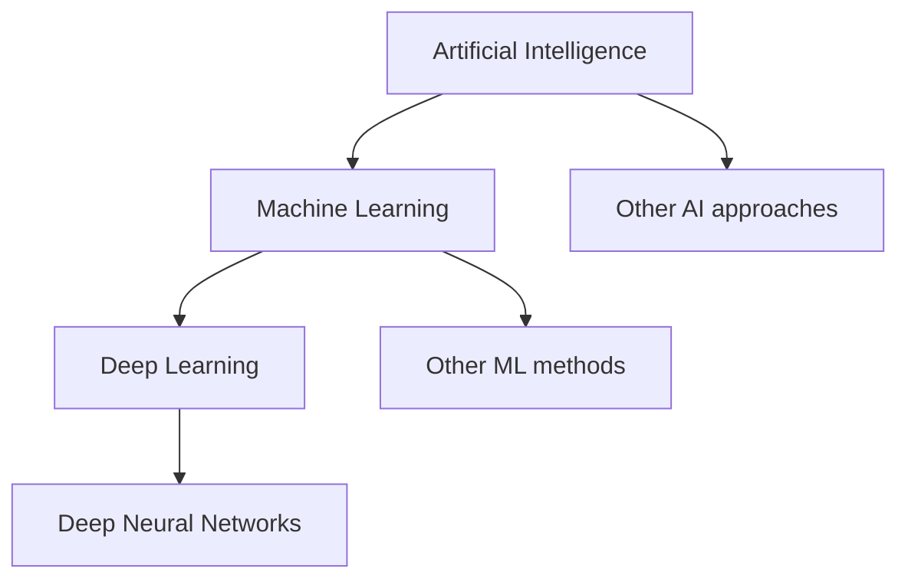

# AI vs. Machine Learning vs. Deep Learning

## Learning objectives

- Explain the relationship between AI, ML and deep learning.
- Identify where neural networks fit.
- Understand why the terms are related but not interchangeable.
- Classify common engineering examples.

## 1. The short answer

- **Artificial intelligence (AI)** is the broad field.
- **Machine learning (ML)** is a set of methods that learn patterns or decision behavior from data or experience.
- **Deep learning (DL)** is a family of machine-learning methods based on neural networks with multiple layers of learned representations.

A useful simplified relationship is:

The diagram is a conceptual nesting, not a complete taxonomy of every research area.

## 2. Artificial intelligence

AI includes systems designed for tasks such as reasoning, search, planning, perception, language and decision-making.

Some systems use explicit rules or symbolic representations. For example, a rule-based troubleshooting expert system can apply human-authored rules to facts supplied by a user.

Other AI systems learn from examples. That leads to machine learning.

## 3. Machine learning

In machine learning, an algorithm uses data or interaction to estimate a model that performs a task.

A common supervised-learning setup contains:

- **Features:** input variables used by the model.
- **Labels or targets:** desired outputs in the training data.
- **Model:** a parameterized function or decision procedure.
- **Loss function:** a measure of prediction error.
- **Training algorithm:** a method for adjusting model parameters.

For example, a house-price model might use floor area, location and property age as features, with historical sale price as the target.

The model learns statistical relationships from examples. It does not automatically discover causation, and historical patterns may not remain valid in the future.

Common ML methods include linear regression, decision trees, random forests, support vector machines, gradient boosting and clustering algorithms.

## 4. Deep learning

Deep learning uses neural networks with multiple layers to learn representations from data.

A simplified neural network contains:

1. An input representation.
2. One or more hidden layers.
3. Learned weights and biases.
4. Nonlinear activation functions.
5. An output layer.
6. A training process that adjusts parameters to reduce a loss.

Deep learning is particularly useful for complex data such as images, audio, video and language. It often benefits from large datasets and substantial compute, although requirements vary by model and task.

Examples include convolutional neural networks for image tasks and transformer architectures for language and multimodal tasks.

## 5. Comparison

| Dimension | AI | Machine learning | Deep learning |
|---|---|---|---|
| Scope | Broad field | Subfield of AI | Subfield of ML |
| Main approaches | Rules, search, planning, learning, hybrids | Statistical and algorithmic learning | Multi-layer neural networks |
| Data requirement | Depends on approach | Often uses data to fit a model | Often data- and compute-intensive |
| Examples | Rule-based planner, game search | Regression, trees, clustering | CNNs, transformers |
| Typical tooling | Varies | Scikit-learn and others | PyTorch, TensorFlow, JAX |

## 6. Where do generative AI and LLMs fit?

Generative AI refers to systems that produce new content, such as text, images, audio or video. It is not synonymous with deep learning, although many modern generative systems use deep neural networks.

A large language model (LLM) is a model trained on language-related objectives and data at scale. Many contemporary LLMs use transformer-based neural networks. An LLM is therefore commonly a deep-learning model and part of the broader generative-AI ecosystem, but not every AI system is an LLM.

## 7. Developer examples

| Application | Likely approach |
|---|---|
| Fixed tax calculation | Conventional deterministic software |
| Rule-based eligibility engine | Rules / symbolic approach |
| Predict customer churn | Supervised ML |
| Group customers by behavior | Unsupervised ML |
| Detect objects in images | Often deep learning |
| Generate a text response | Often a generative model |
| Search documents semantically | Embeddings plus retrieval; may use neural models |

The exact approach depends on the implementation. Product labels alone do not reveal the underlying architecture.

## 8. Common misconceptions

- **"AI always learns by itself."** No. Some AI systems use explicit rules and never train a model.
- **"More layers always mean better results."** No. Architecture, data, objective, optimization and evaluation all matter.
- **"Deep learning makes data preparation irrelevant."** No. Data quality, coverage and labeling remain important.
- **"Generative AI is all of AI."** No. It is one important area within a much broader field.

## 9. Knowledge check

1. Is a rule-based expert system AI? Why?
2. Is every machine-learning model a deep-learning model?
3. Where do neural networks fit in the relationship?
4. Give one example of a useful ML task that does not require deep learning.

## 10. Practical exercise

Classify each system as conventional software, rule-based AI, ML, deep learning, or a hybrid. Explain where the classification is uncertain.

- A calculator.
- A chess engine using search.
- A spam classifier trained on labeled emails.
- An image classifier using a CNN.
- A customer-support application using an LLM, retrieval and business rules.

## 11. Summary

AI is the broad field; machine learning is one major approach within it; deep learning is a family of ML methods based on multi-layer neural networks. Generative AI and LLMs are important modern applications of deep learning, not replacements for the broader AI discipline.

## 12. Further reading

- [Google Machine Learning Crash Course](https://developers.google.com/machine-learning/crash-course)
- [Deep Learning book](https://www.deeplearningbook.org/)
- [Stanford CS229: Machine Learning](https://cs229.stanford.edu/)

---

[← Previous: What Is Artificial Intelligence?](what-is-ai.md) · [Next: A Short History of Artificial Intelligence →](history-of-ai.md)
