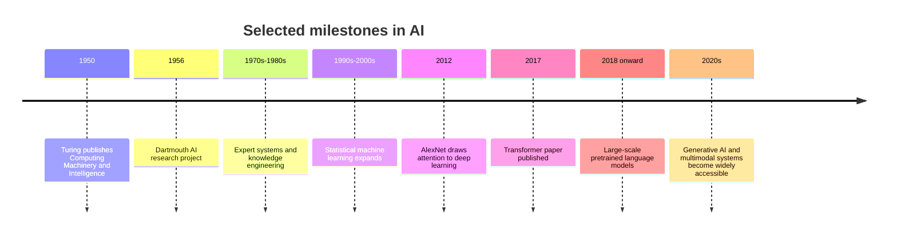

# A Short History of Artificial Intelligence

## Learning objectives

- Recognize major milestones in AI research.
- Understand the shifts between symbolic, statistical and neural approaches.
- Explain why progress has not been a straight line.
- Place modern generative AI in historical context.

## 1. Before the name "artificial intelligence"

Ideas about mechanical reasoning, formal logic and computation developed long before AI became a named research field. Mathematical logic, probability, information theory and the theory of computation helped establish foundations for asking whether machines could perform reasoning-like tasks.

In 1950, Alan Turing published ["Computing Machinery and Intelligence"](https://academic.oup.com/mind/article/LIX/236/433/986238), which proposed the imitation game as a way to discuss machine intelligence. It did not settle the philosophical question of intelligence, but it became an influential reference point.

## 2. The field takes shape

The [1955 Dartmouth proposal for the 1956 summer research project](http://jmc.stanford.edu/articles/dartmouth/dartmouth.pdf) is commonly associated with the formal launch of AI as a research field. Early researchers explored symbolic reasoning, theorem proving, game playing and problem solving.

A central idea in symbolic AI was that knowledge and reasoning could be represented explicitly through symbols and rules.

## 3. Early optimism and limitations

Early demonstrations solved carefully constrained problems. However, real-world environments were more complex than many early systems could handle.

Challenges included:

- Limited computing power and memory.
- Difficulty representing common-sense knowledge.
- Brittle rules that did not generalize well.
- Inadequate data and uncertain environments.
- Expectations that exceeded demonstrated capabilities.

Periods of reduced funding and enthusiasm are often called **AI winters**. The history is not a single on/off cycle; different subfields progressed at different rates.

## 4. Expert systems

In the 1970s and 1980s, expert systems attempted to capture specialist knowledge in explicit rules and knowledge bases. They were useful in some constrained domains but expensive to maintain and difficult to scale when rules changed or exceptions multiplied.

This period demonstrated that useful AI could be built without modern deep learning, while also revealing the limits of manually encoded knowledge.

## 5. Statistical machine learning

As datasets, computing and statistical methods improved, learning from examples became increasingly important.

Approaches such as decision trees, support vector machines, probabilistic models and ensemble methods became widely used. Instead of manually specifying every decision rule, engineers could fit models to data and evaluate their generalization.

## 6. Neural networks and deep learning resurgence

Neural networks had been studied for decades. Improvements in algorithms, datasets, hardware and training practices helped make deeper networks more practical.

Important developments included:

- Backpropagation becoming a widely used method for training multi-layer networks.
- Convolutional neural networks achieving strong results in image recognition.
- Recurrent architectures being used for sequential data.
- GPUs making large-scale numerical computation more accessible.

The [2012 ImageNet result associated with AlexNet](https://proceedings.neurips.cc/paper/2012/hash/c399862d3b9d6b76c8436e924a68c45b-Abstract.html) is often cited as a major milestone in modern deep learning, but it built on earlier work in neural networks, computer vision and large-scale datasets.

## 7. Transformers and foundation models

The 2017 paper ["Attention Is All You Need"](https://arxiv.org/abs/1706.03762) introduced the Transformer architecture. Transformers later became central to many language models and multimodal systems.

Subsequent developments included:

- Large-scale language-model pretraining.
- Transfer learning and fine-tuning.
- Instruction tuning and preference-based alignment methods.
- Models capable of processing multiple modalities.
- More capable inference and deployment systems.

The release of widely accessible conversational systems brought LLMs to a much broader audience and accelerated application development.

## 8. A simplified timeline

This is a selective teaching timeline, not an exhaustive history. Important work in logic, robotics, planning, speech, vision and machine learning occurred throughout these periods.

## 9. What history teaches developers

1. AI progress is not linear.
2. New approaches often build on decades of earlier work.
3. Compute, data, algorithms and engineering all matter.
4. A successful research result does not automatically make a reliable product.
5. Hype can obscure limitations; evaluate systems against real tasks.

## 10. Knowledge check

1. What is symbolic AI?
2. Why did expert systems become difficult to maintain?
3. Why was the 2012 ImageNet result influential?
4. What did the 2017 Transformer paper contribute?
5. Why should developers distinguish research milestones from production readiness?

## 11. Further reading

- [Alan Turing, Computing Machinery and Intelligence (1950)](https://academic.oup.com/mind/article/LIX/236/433/986238)
- [Dartmouth AI Project proposal](http://jmc.stanford.edu/articles/dartmouth/dartmouth.pdf)
- [ImageNet Classification with Deep Convolutional Neural Networks](https://proceedings.neurips.cc/paper/2012/hash/c399862d3b9d6b76c8436e924a68c45b-Abstract.html)
- [Attention Is All You Need](https://arxiv.org/abs/1706.03762)
