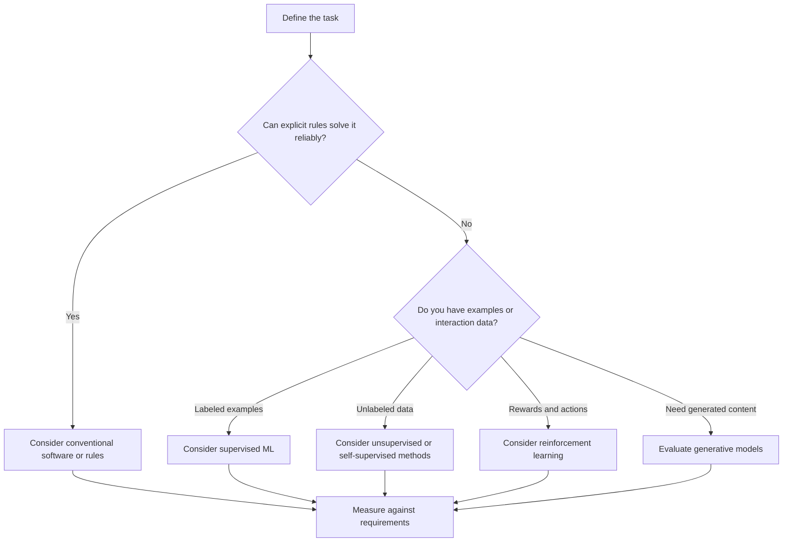

# Major Approaches and Types of AI

## Learning objectives

- Distinguish AI capability labels from technical approaches.
- Understand symbolic, statistical and learning-based approaches.
- Recognize common machine-learning categories.
- Avoid misleading claims about AGI and superintelligence.

## 1. There is more than one way to classify AI

People use the phrase "types of AI" to mean different things. Two common classification schemes are:

1. **By capability:** how broad or general the system's abilities are.
2. **By technical approach:** how the system represents knowledge, learns or makes decisions.

These schemes should not be mixed together.

## 2. Capability-based labels

### Narrow AI

Narrow AI describes systems designed for a bounded set of tasks. A system may perform extremely well within its intended scope without having broad, human-like general intelligence.

Most deployed AI products today are narrow systems, even when they support many related tasks.

### Artificial General Intelligence (AGI)

AGI is a debated concept referring broadly to AI with general capabilities across a wide range of tasks. There is no universally accepted operational test or single agreed threshold that settles whether a system qualifies. Treat claims about AGI as dependent on the definition and evaluation criteria being used.

When discussing AGI, define the capability criteria rather than treating the label as a settled technical category.

### Artificial Superintelligence (ASI)

ASI is a hypothetical concept referring to intelligence that substantially exceeds human capabilities across many important domains. It is a topic of research, forecasting and debate, not a description of an established deployed system.

## 3. Approach-based categories

### Symbolic and rule-based AI

Knowledge is represented explicitly, for example as rules, logic statements or structured facts.

Example:

```text
IF account_status = "blocked"
THEN deny_transaction
```

Advantages:
- Rules can be inspected.
- Behavior can be predictable in well-defined cases.
- Domain constraints can be expressed explicitly.

Limitations:
- Rule sets can become brittle.
- Maintaining exceptions is difficult.
- Unstructured data can be challenging to represent.

### Search and planning

A system explores possible states or action sequences to find a solution. Search is used in games, route planning, scheduling and automated planning.

Examples include breadth-first search, A* search and minimax.

### Probabilistic AI

Probabilistic methods represent uncertainty and reason using probability distributions. Bayesian networks and probabilistic inference are examples.

### Machine learning

Machine-learning systems estimate patterns or decision behavior from data or interaction.

Common categories include:

- Supervised learning.
- Unsupervised learning.
- Semi-supervised learning.
- Self-supervised learning.
- Reinforcement learning.

These categories describe learning setups, not mutually exclusive product types.

### Deep learning

Deep learning uses multi-layer neural networks to learn representations and mappings from data.

### Generative AI

Generative systems produce new outputs such as text, images, audio, video or structured data. They may use autoregressive models, diffusion models and other generative approaches.

### Hybrid AI

Hybrid systems combine techniques. A production application might use a neural model for language understanding, a database for factual records, deterministic rules for authorization and a search algorithm for planning.

## 4. Machine-learning learning setups

| Setup | Training signal | Example |
|---|---|---|
| Supervised | Labeled examples | Classify support tickets |
| Unsupervised | Structure in data without supplied target labels | Cluster customers |
| Semi-supervised | Small labeled set plus larger unlabeled set | Image classification |
| Self-supervised | Targets derived from the data itself | Predict masked or next tokens |
| Reinforcement | Rewards from actions and outcomes | Learn a control policy |

Real systems can combine these approaches at different stages.

## 5. A decision guide for developers



This is only a starting point. Real solution selection also depends on accuracy requirements, explainability, data access, privacy, latency, cost, maintainability and risk. The [NIST AI Risk Management Framework](https://www.nist.gov/itl/ai-risk-management-framework) provides additional context for identifying and managing system risks.

## 6. Common misconceptions

- AGI is not simply a larger language model.
- "Generative" does not mean the output is true or original in a legal sense.
- Deep learning is not always the best choice for tabular data.
- A hybrid system may be more reliable than using a model for every step.
- A model's benchmark score does not establish suitability for a particular application.

## 7. Knowledge check

1. What is the difference between a capability label and a technical approach?
2. Give an example of a hybrid AI system.
3. How do supervised and self-supervised learning differ?
4. Why is AGI difficult to define precisely?
5. What factors besides accuracy should influence model selection?

## 8. Practical exercise

Design a simple architecture for an expense categorization application. Decide which parts should use deterministic rules, which parts might use ML, and where a human should review uncertain predictions. Explain your choices.

## 9. Further reading

- [Google Machine Learning Glossary](https://developers.google.com/machine-learning/glossary)
- [Stanford CS221: Artificial Intelligence](https://stanford-cs221.github.io/autumn2026/)
- [NIST AI Risk Management Framework](https://www.nist.gov/itl/ai-risk-management-framework)
