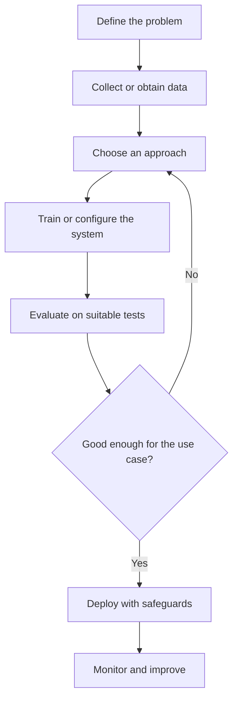

# What Is Artificial Intelligence?

## Learning objectives

By the end of this lesson, you should be able to:

- Explain artificial intelligence in plain language.
- Distinguish an AI system from an ordinary deterministic program.
- Identify the main ways AI systems are built.
- Recognize the limitations of AI systems.

## 1. A practical definition

Artificial intelligence (AI) is a broad field of computer science concerned with building systems that perform tasks commonly associated with aspects of intelligence. This is a practical teaching definition; the [Stanford Encyclopedia of Philosophy overview of AI](https://plato.stanford.edu/entries/artificial-intelligence/) discusses the field's broader history and definitions. Examples include recognizing patterns, understanding or generating language, making predictions, planning actions and interpreting images.

There is no single implementation called "AI." The field includes many different approaches, from explicit rules written by people to statistical models learned from data.

A useful way to think about an AI system is:

1. It receives input from an environment or user.
2. It processes that input using rules, learned parameters, or a combination.
3. It produces a prediction, classification, recommendation, generated output or action.
4. Its output is evaluated against a goal or desired outcome.

This is a teaching model, not a claim that every AI system has the same architecture.

## 2. Ordinary software versus learned behavior

Consider a tax calculator. A developer explicitly writes the rules and formulas. Given the same valid input and program version, it normally produces the same result.

Now consider an email spam classifier. A developer chooses an algorithm and provides examples of spam and legitimate messages. The training process estimates model parameters that help distinguish the categories. The developer does not manually write a rule for every possible spam message.

Both are software. The difference is where much of the decision logic comes from:

- **Explicitly programmed system:** behavior is primarily specified by human-authored instructions.
- **Machine-learning system:** behavior is partly determined by parameters estimated from data.
- **Hybrid system:** combines learned models with rules, search, databases and conventional software.

Machine learning is one important approach within AI, but it is not the whole field.

## 3. Common AI capabilities

| Capability | Example task |
|---|---|
| Perception | Detect objects in an image |
| Language | Classify or summarize a document |
| Prediction | Estimate future product demand |
| Recommendation | Rank products for a user |
| Planning | Find a sequence of actions to reach a goal |
| Generation | Produce text, images or audio |
| Control | Adjust a robot's movement |

A product may combine several capabilities. A voice assistant, for example, may use speech recognition, language processing, retrieval, a language model and speech synthesis.

## 4. A simple AI system lifecycle

Not every AI system is trained by its user. A developer integrating a hosted foundation model may use an already-trained model and focus on prompts, tools, retrieval, evaluation and application controls.

## 5. AI is not magic

AI systems have limitations:

- They can make incorrect predictions or generate false statements.
- Performance depends on the task, data, model and operating conditions.
- A model that performs well on one dataset may fail on a different population or environment.
- Some systems are difficult to interpret.
- Training and inference can require substantial compute, energy and money.
- Outputs can reflect biases or gaps in the data and design process.

A fluent answer is not proof of correctness. High-impact applications need appropriate testing, human oversight and domain-specific safeguards.

## 6. Where developers encounter AI

A software engineer may use AI in several ways:

- Call a hosted model through an API.
- Run an open-weight model on local or cloud infrastructure.
- Train a classical machine-learning model.
- Add semantic search to an existing application.
- Build a retrieval-augmented generation (RAG) system.
- Give a model access to carefully controlled tools.
- Monitor quality, latency, cost and safety in production.

These are different engineering problems. Choosing an approach begins with understanding the actual user need, data sensitivity, reliability requirements, latency and budget.

## 7. Knowledge check

1. Is every AI system a machine-learning system? Explain.
2. What is one difference between explicit rules and learned model parameters?
3. Why is a fluent generated answer not necessarily a correct answer?
4. Name two AI capabilities that may be combined in a voice assistant.

## 8. Practical exercise

Choose three applications you use regularly. For each one:

- Identify the task that may involve AI.
- State what input the system receives.
- State what output or action it produces.
- Identify one way the system could fail.
- Suggest how you would evaluate whether it works well.

## 9. Summary

AI is an umbrella field covering multiple approaches to building systems that perform tasks associated with intelligent behavior. Machine learning is a major subset, but rule-based reasoning, search, planning and hybrid systems are also part of the field. Responsible engineering requires evaluation and an understanding of limitations.

## 10. Further reading

- [Stanford Encyclopedia of Philosophy: Artificial Intelligence](https://plato.stanford.edu/entries/artificial-intelligence/)
- [NIST CSRC: AI glossary entry](https://csrc.nist.gov/glossary/term/AI)
- [Google Machine Learning Crash Course](https://developers.google.com/machine-learning/crash-course)

---

[Next lesson: AI vs. Machine Learning vs. Deep Learning →](ai-vs-ml-vs-dl.md)
